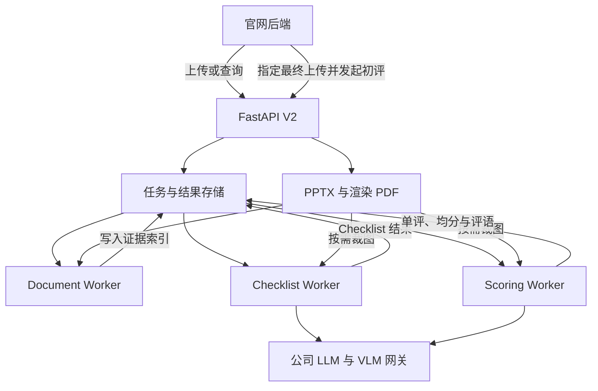
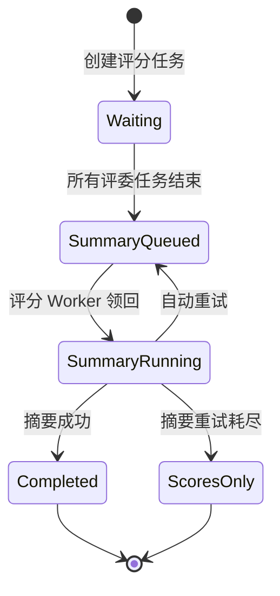

# Robotic Workshop 初赛 AI 评审 V2

V2 用一套服务交付两项能力。参赛者上传 PPTX 后获得带原页证据的 Checklist。官网确定正式参评的那次上传后，评委获得 A1–B3 六项初评、单评理由和汇总意见。官网负责参赛权限、最终评分与排名。Windows 启动、联调例子和部署命令见 [V2 启动与 API](Operations_V2.md)。

## 1. 架构

| 角色 | 处理内容 |
|---|---|
| FastAPI | 提供两个 `POST` 路径，分别处理 Checklist 和评分。每个路径同时受理任务和查询。受理后返回 `202`，官网按任务 ID 获取结果。 |
| Document Worker | 生成一份可复用的页与对象索引。包含视觉对象时尝试为同一 PPTX 生成一份内部 PDF，供后续工具即时裁图。 |
| Checklist Worker | 按正式条目逐项启动 Deep Agents。先读首选页，证据不足时继续查符合条件的正文页，返回通过、缺项或待确认。 |
| Scoring Worker | 为配置中的每位模型评委领取独立任务。各自对 A1–B3 逐项评分，随后聚合分数并生成文字摘要。 |
| 存储 | 本地用 SQLite 和本地文件。多实例部署用 PostgreSQL 和共享对象存储。任务与索引走数据库，原 PPTX 和渲染 PDF 走文件或对象存储。 |

**任务与文件关联。** 上传次数由 Checklist `job_id` 区分。同一参赛编号的多次上传可以并存。官网提交 `upload_job_ids` 来选定正式参评材料。证据可用后即可发起评分，Checklist 结果和评分可独立完成。相同上传、规则和模型配置重复发起评分时，服务复用已有评分任务。

## 2. 方案及选型原因

| 选型 | 原因与取舍 |
|---|---|
| **FastAPI + 后台 Worker** | 上传有复杂文件解析，评审有多轮模型调用。异步任务让官网尽快拿到任务 ID，并可查询阶段进度。两套接口分别持有上传和评委凭据。 |
| **PPTX 原生解析** | `python-pptx` 先提取文字、表格、图表和形状。直接读取形状与连接线能保留原对象 ID、几何位置和关系，给官网提供可定位的证据。解析使用 CPU。 |
| **LibreOffice + pypdfium2 + VLM** | 截图、图标、复杂图表需要看原图。LibreOffice 负责渲染，pypdfium2 按对象坐标裁图，VLM 回答具体证据问题。已定位区域可直接读图。目标藏在混合截图里时，先定位再读细节。字体和排版保真需要用实际模板验收。 |
| **Deep Agents + 两份 Skill** | 评审需要按情况翻页、读连接线、裁图和计算。Skill 负责描述判定过程，工具负责取证，Python 核对引用和分数。Checklist 条目、锚点、评分条件和档位都在 JSON 里按版本管理。 |
| **OpenAI 兼容的模型 profile** | 同一代码可按配置选择 Checklist、读图、评委和摘要模型。默认双模型各评一次，便于暴露分歧和保留单评结果。不同模型的评分准确性及实际成本通过双人工评委样本比较。 |
| **Python 聚合 + LLM 摘要** | 等权均分与分差由程序计算，可复核每一项。模型只用已核验的单评生成评语、证据和复核建议。可在摘要尚未完成时先展示已有数值和原始理由。 |
| **可续跑的逐项记录** | 一份稿件默认有 2 位评委 × 6 项评分。评委每完成一项就写一次，可在中断后跳过已保存条目。Celery/Redis 可用于内网调度，本地启动用同样的 Worker 处理逻辑。 |

## 3. 代码 Pipeline

### 3.1 接件与文档取证

1. `api.py` 中的 `request_checklist` 处理上传。中间件先鉴权并限制请求体，服务校验 PPTX 包格式，保存原文件，创建 `document / queued` 任务并返回上传 ID。
2. `Service.parse` 调用 `presentation.extract`。`mapped_pages` 优先匹配标题锚点，无匹配时可按模板位置回退。七页是逻辑模板，上传页数可以浮动。隐藏页和未映射的附页不纳入取证，能匹配模板锚点的后续正文页保留原物理页码。
3. 递归提取文字、原生表格、可读取的图表序列、形状和嵌套组坐标。配置空白模板时，清除同逻辑页上与模板完全相同的归一化对象文字。对象证据 ID 形如 `p4-s12`，页框坐标按 0–1000 归一化。
4. `flow_graph` 优先从 OOXML 读取连接线端点和箭头方向。缺失绑定时，端点附近只有一个候选节点才推断连接。分支短标签按到候选直线的投影距离关联。曲线、交叉或端点歧义可用视觉工具辅助验证。
5. 如有视觉对象，尝试渲染原 PPTX，以输出 PDF 与原稿页数一致为前提保存。渲染失败时记录告警，保留原生索引。Checklist 和初评都从这一份索引读取，渲染 PDF 在评审工具实际取图时才转为 PNG。

### 3.2 Checklist 逐项执行

1. `review.checklist` 为每个条目创建独立 `Evidence`。`evaluate` 加载 `workshop-checklist` Skill，传入条目规则、实际首选页和可查页列表。工具访问控制要求首选页存在时先访问它，再跨页补查。
2. Agent 分批调用下表工具，根据条目要求查证。同一页通常最多回传 12 个文本片段，单片段最多 1,200 字符。原生流程一次回传最多 20 条连线。对图片先用对象框读取，复杂截图允许先返回一个裁图区域，再读取局部。
3. `checked_reply` 校验引用属于这次 Agent 已访问的证据。模型给出 `present` 且引用有效时返回通过。`missing` 还需要满足可用页、必要图块和流程证据的覆盖校验。证据不全、模型格式错误或关键图片难以读清时，可返回 `uncertain`。模型传输失败按 Worker 策略重试。
4. API 查询返回逐项状态、实际证据页码与区域、补充提示和总体计数。跨正文页找到有效证据时保持 `present`。

| Agent 工具 | 读到的内容 |
|---|---|
| `read_file` | 受限目录里的 Skill Markdown。 |
| `read_slide` | 指定物理页的文字、表格或图表片段和对象坐标。 |
| `read_flow` | 连接线的来源、目标、方向、关联标签和来源类型。 |
| `locate_visual` / `inspect_visual` | 前者让 VLM 返回候选框，后者读取对象裁图或已定位区域，证据引用仍可回到原 PPTX 页。 |
| `calculate_ratio` | 评分 Skill 可使用的比率计算器，输入分子、分母和可选乘数。模型仍负责选择公式、引用来源及解释单位。 |

### 3.3 独立评分、聚合与汇总

1. `request_scoring` 校验上传 ID、证据和规则摘要。`Repository.insert_scoring` 原子创建评分父任务及对应的模型评委子任务。模型配置给定 1–3 个 profile，默认是两个。
2. `Service.judge` 按 A/B/C 组读取对应 Rubric。每位评委针对 A1–B3 各自执行 `workshop-scoring`，仅能看到自己的会话和共享原始证据。
3. `review.score_item` 检查分数、档位、理由和证据引用。只在规则明确给了 `missing_score` 且确认缺项时使用缺证分。其他无法有效打分的项返回 `score: null` 与复核标记。每份单评立即保存。发生异常后下轮只补未保存的项。
4. 每位评委进入完成或失败后，父任务才进入摘要阶段。`aggregate` 先保存 A1–B3 的有效评委数、预计评委数、均分和分差。均分是有效分数的等权算术平均，只有评委齐全才计算。分差为最高分减最低分，至少两个有效分数才计算。两位评委只返回一份分数时，保留 `1/2` 进度和已评明细，该项均分为 `null`。
5. `synthesize` 根据已验证的单评写六项评语和一段总体意见，摘要引用需属于对应评分项。单评档位分歧、评委缺分和类型化复核标记会传到结果。摘要失败时保留分数，自动重试或以 `summary_status: failed` 结束。

### 3.4 关键文件与维护位置

| 需求 | 代码或配置 |
|---|---|
| 接口、鉴权、请求大小、入参校验 | [app/v2/api.py](../app/v2/api.py) |
| 阶段调度、续租、解析、评委与汇总 | [app/v2/service.py](../app/v2/service.py) |
| PPTX、页映射、流程线、PDF 裁图 | [app/v2/presentation.py](../app/v2/presentation.py) |
| Agent、证据工具、Checklist 与单评校验 | [app/v2/review.py](../app/v2/review.py) |
| 规则判断方法 | [Checklist Skill](../app/v2/skills/workshop-checklist/SKILL.md) · [评分 Skill](../app/v2/skills/workshop-scoring/SKILL.md) |
| 业务规则与模型路由 | [联调规则 JSON](../configs/sample.json) · [模型配置 JSON](../configs/models-v2.json) · [配置加载](../app/v2/models.py) |
| 任务存储、领取、重试、逐项保存 | [app/v2/repository.py](../app/v2/repository.py) · [app/storage.py](../app/storage.py) |
| 三种 Worker 启动、Celery 轮询 | [app/v2/worker.py](../app/v2/worker.py) |
| 离线验证 | [scripts/test_v2.py](../scripts/test_v2.py) |

## 4. 运行和验收边界

`rw_v2_jobs` 记录上传、评分父任务和评委任务。`rw_v2_judge_scores` 按评委任务与评分项唯一保存。Worker 每个任务阶段最多执行三次，领取时设置 120 秒租约，正常运行时每 25 秒续租。另一个 Worker 接管后，持有旧租约的 Worker 无法提交结果。摘要重试以已写入的分数为输入。

规则、模板和 Skill 内容参与规则摘要，模型 profile、实际模型 ID 和 endpoint 参与模型配置摘要。变更先让当前任务结束，再重启各角色。换规则或模板时，对正式参评的 PPTX 重新建立索引。多模型初评继续复用同一份提案证据。

本地离线用例覆盖页映射、流程线、两个 API、评分中断恢复、Skill 与图片工具调用。正式环境验收应使用定版 PPTX 模板、Checklist 和 A/B/C Rubric，验证跨页、附页、复杂流程箭头、中文字体、图表与裁图准确性。使用内网模型确认工具调用和图片输入，再基于人工双评结果测量误差、证据准确性及 P95 耗时。
