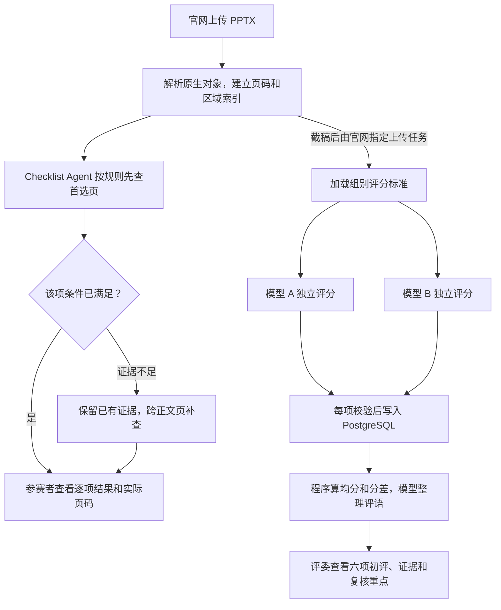

# Robotic Workshop 初赛 AI 评审 Pipeline V2

**方案评审稿 · 2026-11-24**

初赛沿用一个对外 AI Service。官网传入参赛者的 **PPTX**，上传后先返回参赛者 Checklist。截稿后，官网指定最终参评的那次上传，服务再为评委生成 A1–B3 六项初评。官网负责提交权限、正式成绩和排名。预计约 200 份提案。

**首版采用 Deep Agents、两个业务 Skill、两位不同模型评委各评一次。** Agent 根据证据决定下一步查文字、读流程图还是看局部截图。服务负责完整执行条目、校验证据、记录进度和计算分数。

## 1. 一份提案如何走完全程

**对接契约。** 建议 `POST /v2/checklist-jobs` 接收 `submission_id`、`category`、`pptx`，返回 `202 + job_id`。截稿后 `POST /v2/scoring-jobs` 接收一批最终参评的上传任务 ID，每份返回一个评分任务 ID。官网通过原 POST 路径查询。Checklist 通过查询参数传入 `job_id`，评分通过 JSON 请求体传入 `job_id`。任务 ID 把评审锁定到具体文件，官网无需提供提交版本号。评分就绪条件是该文件的证据可用，Checklist 缺项由评委依据正式规则处理。

## 2. 一次解析，两条流程共用证据

用 `python-pptx` 读取文字、原生表格、图表、图片和形状，必要时读取 OOXML。记录实际页码、对象或区域 ID、位置及原文。遇到需要读图的条目，在内网以固定字体用 LibreOffice 渲染同一份 PPTX，再用 pypdfium2 生成所需页图和裁图。两条流程共用原件、索引和已生成的图。公司 VLM 负责图片理解，首版无需部署独立 OCR。官网收取的 PDF 可继续用于人工预览。

| 证据情形 | 首版处理方式 |
|---|---|
| 可编辑文字、表格和图表 | 直接读取原文、行列、系列和单位。和空白模板对照，排除提示语、示例值、备注及隐藏内容。索引里有对象仅表明有候选材料，是否满足要求由规则和模型判定。 |
| 原生流程框线图 | 从形状、连接线端点和箭头方向恢复上下游，将群组坐标换算到画布。判断节点的 Y/N 标签优先匹配该节点出边，比较到实际线段的投影距离。交叉、并线或未绑定引起歧义时，保留疑点并查原图。 |
| 目标图能定位 | 单一主图直接读；同页多图用对象坐标裁切。给 VLM 目标图和附近文字，必要时附整页缩略图。一次视觉判断即可尝试回答。 |
| 目标藏在混合截图中 | 只有定位困难时才分两次调用。第一次在整页定位，程序从原始渲染图裁出高清区域，第二次读取目标细节。缓存带区域引用的观察结果。描述未覆盖的问题允许回看原图。 |

## 3. 一个框架、两个 Skill

服务按任务类型指定 Skill。每个 Skill 用 `SKILL.md` 说明判定方法。业务人员在规则 JSON 中维护必填项、判档条件和分数区间。单次任务固定所用规则的版本或摘要。两个 Agent 都通过受限工具查本提案的文字、表格、流程图和裁图，服务端校验条目 ID、证据归属及返回结构。公司平台接入时需验证相同 Skill 目录及工具契约。[Deep Agents Skills 文档](https://docs.langchain.com/oss/python/deepagents/skills)

**参赛者 · `workshop-checklist`**

1. 七页模板仅定义每项的首选页。页数差异照常处理，多出的附加页跳过。用模板标题或标识识别正文，保留实际页码。首选页缺失时直接补查其他正文页。
2. 大部分条目由模型做语义判断。每次按首选页和条目规则组织一个 Agent 调用。跨页时补查未满足的条件。按需送证据，避免让模型一次处理整份提案。
3. 任一正文页证据充分即返回 `present`（前端显示 OK）。一个条目的条件也可以分布在不同页，合并前核对对象、单位和统计口径。可判定范围已查完且确实缺项时返回 `missing` 和补充提示。关键图读不清或证据冲突时返回 `uncertain` 和原因。每个正式条目恰好返回一次，给出的证据引用能定位回实际页及对象。

**评委 · `workshop-scoring`**

1. 按 A/B/C 组载入对应 Rubric。默认配置两种经验证合格的内网模型，各用独立会话执行一次相同 Skill。两位评委可访问同一份原始证据，单评期间互相看不到结论。模型厂商、端点、实际模型 ID、调用并发由服务配置管理。
2. 每位评委分别判断 A1、A2、A3、B1、B2、B3 的细分条件，给出等级、区间内分数、引用证据及理由。UPH、ROI 等涉及计算的项目，按正式公式、可核实的输入和单位由程序复算。缺证分仅按正式 Rubric 的明文规定给出，其余无法判定的项留待复核。
3. 两个有效分数收齐后，程序计算每项等权均分、分差和有效评委数。跨档或关键事实解释冲突时保留单评并标记复核。某项只有一位给出有效分数时展示 `1/2` 和已有理由，该项均分留空。首轮联调可以显式配置一位评委，结果标注实际名单。
4. 两位独立评分结束后，用已有模型端点开启单独的汇总会话，根据验证过的逐项理由和证据整理共识、分歧、复核重点，再生成整体评语。均分由程序填入。汇总失败时先展示已有分数及原始理由，仅重试摘要。

## 4. 怎么运行、怎么恢复

首版沿用 FastAPI、现有 Worker 机制及公司内网模型 API。运行角色为 **1 个 API、1 个文档 Worker、1 个 Checklist Worker、1 个评分 Worker**，生产部署复用现有 Celery 调度器和 Redis。两位评委是评分 Worker 可领取的独立任务，无需按模型另开服务。并发初始上限为两个评委任务，再按各端点配额调整。PPTX 解析与渲染使用 CPU，模型推理由内网端点承担。

| 存放位置 | 记录内容 |
|---|---|
| PostgreSQL `rw_v2_jobs` | 本次上传或评分任务、对应原件、Skill 版本、期望评委名单、对外结果与摘要状态。 |
| PostgreSQL `rw_v2_jobs`（judge 作业） | 一位评委的一轮独立运行，记录模型、状态、租约和重试。 |
| PostgreSQL `rw_v2_judge_scores` | 一位评委的一项结果，保存分数、等级、理由、证据 ID 和复核标记。`(judge_run_id, criterion_id)` 唯一。 |
| 内网文件或对象存储 | 原始 PPTX、页图和局部裁图，按本次上传和证据 ID 关联。 |

每项通过校验就写 PG。Worker 中断后续跑未完成项；暂时性调用失败重试同一轮次，提交结果时核对租约，避免过期任务覆盖有效结果。两位评委各跑一次，每份有 12 条单评记录。另一个评委超时或模型汇总失败，已经完成的分数仍可查询。

## 5. 审核通过后的实现顺序

| 顺序 | 可演示的交付 | 验证重点 |
|---|---|---|
| 1 · 跑通一份提案 | PPTX 上传、原生证据索引、页图和裁图工具、真实内网模型加载 Checklist Skill。 | 提交文字内容相同、图片内分支方向相反的两份样例，验证模型确实收到图，能指出不同区域。 |
| 2 · 完成参赛者 Checklist | 接入正式条目，完成首选页检查、跨页补查和三态输出。 | 同页与跨页命中、缺页、额外页、模板残留、低清图。记录关键缺项漏检、误报、证据正确率和 Checklist 单独的 P95。 |
| 3 · 完成评委初评 | 两个模型独立评分、PG 逐项保存、均分、逐项与整体评语。 | 模拟单评中断和摘要失败，核对恢复与计票。在人工双评样本上比较单模型重复与双模型各一次的逐项误差、等级及证据质量。 |

正式验收需要空白 PPTX 模板、正式 Checklist、三组评分表、有人工标注的代表性提案，以及已获准的内网模型端点。正式稿到位前可以用合成样例验证流程。框架、主流程和交付边界按本稿审核，评分准确率、模型配对与时延以目标环境实测为准。
