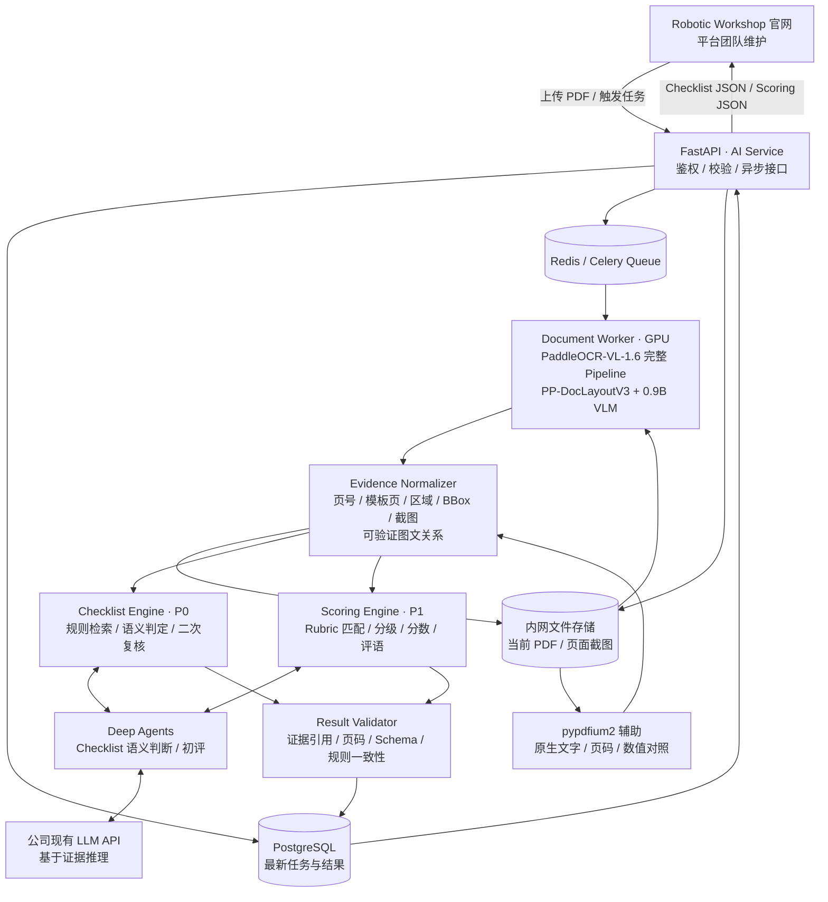

# Robotic Workshop 初赛 AI Service 实施设计

**V1.2 · 初赛 Agent 实施版 · 目标交付 2026-12-03**

## 1. 12 月 3 日交付什么

| 使用者 | 交付项 | 输出与使用方式 |
|---|---|---|
| 参赛者 | **Checklist（P0，实施优先）** | 上传 PDF 后逐项查看已提供、缺失或待确认。显示证据页码或缺项提示，修改重传后查看最新版结果。 |
| 评委 | **AI 初评（P1，同日交付）** | 截稿后对最终有效版本批量初评，输出 A1–B3 六项评分、等级、理由、证据，以及一份整体评语 Summary，概括亮点、主要不足和人工复核重点。 |

初赛预计约 200 份作品，模板约七页。参赛者提交 PPT 和 PDF，AI Service 分析 PDF，PPT 由官网保存。官网前端、身份权限、提交限制、Excel 和最终成绩由平台团队负责。复赛、决赛、CAD 和视频分析留待后续阶段。

## 2. 一次 PDF 解析，支撑两条业务流程

选型优先看 Checklist 正确性、图文证据可追溯性、内网资源和实施工期。采用 PaddleOCR-VL-1.6 官方完整 Pipeline，含 PP-DocLayoutV3 和 0.9B 区域识别模型。pypdfium2 辅助校对原生文字、数字和页码。公司 LLM 负责证据约束下的语义判断与评分。真实效果以提案回归和 GPU 实测为准。



**架构要点**：共享**一次**文档解析结果，Checklist 和 Scoring 分开运行；Scoring 不阻塞 Checklist；所有评分与缺失判断必须关联实际页/区域证据。图中的两条 AI 业务路径不代表部署两套文档 OCR。

**共享证据层**保留物理页码、模板逻辑页、区域 ID、类型、BBox 和坐标系、文字、表格以及截图引用。原生文字或数字与模型结果冲突时复查原图。图中连线和关系经证据核实后才标记为已验证。

**Checklist**按模板配置检索证据，未命中时复查对应页、跨页和必要的局部区域。逐项返回 `present`、`missing` 或 `uncertain`。跨页发现的内容记录实际页码，是否通过按 PM 确认的规则执行。全部规则执行后才标记完成。

**AI 初评**复用最终版本证据，按组别加载版本化 Rubric。先判断细分条件，再定等级和区间内分数。代码校验六项齐全、分数区间和实际证据引用，依据不足时标记 `needs_review`。正式评分表中的 UPH、ROI 等定量指标应提供可复算的公式、单位及数据来源，供评委核对。整体评语仅从经校验的逐项结果归纳，保留相应证据。

初赛已接入 LangChain Deep Agents。Checklist 的语义判断、各评分项的条件核对及评分均在单提案证据范围运行。模型接收规则和证据，服务端负责指定流程、判分边界、校验证据以及版本发布。后续可在官网扩展会话式评委助手，初期提供只读的证据定位和评分理由查询。

## 3. API 契约与版本一致性

**协议**：内网 HTTPS，服务对服务鉴权（Token/公司网关），JSON 响应，长任务统一 `202 Accepted`。不负责前端与权限列表。

| Method | Path | 用途 | 响应 |
|---|---|---|---|
| `POST` | `/v1/checklist-jobs` | 提交 PDF + `submission_id`、`revision`、`category`、`request_id` | `202` + `job_id` |
| `GET` | `/v1/jobs/{job_id}` | 查询 `queued / running / completed / failed / superseded` | 任务状态/错误码 |
| `GET` | `/v1/submissions/{submission_id}/checklist` | 获取**当前有效 revision**的 Checklist | Checklist JSON |
| `POST` | `/v1/scoring-jobs` | 由平台截止后触发一份或一批提交的 AI 预评分 | `202` + 作业 ID |
| `GET` | `/v1/submissions/{submission_id}/evaluation` | 取得最新有效版本的六项评分 | Scoring JSON |
| `GET` | `/health/live`、`/health/ready` | 容器存活、依赖就绪检查 | Health JSON |

**Checklist 结果示例（示意内容，不是真实规则）**

```json
{
  "submission_id": "RW-2026-001",
  "revision": 3,
  "rules_version": "demo-v1",
  "parser": "PaddleOCR-VL-1.6",
  "status": "completed",
  "items": [
    {"item_id": "P1-DETAIL", "title": "作业说明", "template_page": 1, "status": "present", "evidence_pages": [1], "hint": null}
  ],
  "summary": {"present": 1, "missing": 0, "uncertain": 0}
}
```

Checklist 仅向参赛者显示完整性和缺项提示。完整字段详见 [OpenAPI](openapi.json)。

**评分结果示例（示意格式）**

```json
{
  "submission_id": "RW-2026-001",
  "revision": 3,
  "category": "A",
  "rubric_version": "demo-v1",
  "status": "completed",
  "criteria": [
    {
      "id": "A1",
      "score": 82.5,
      "level": "supported",
      "reasons": [{"text": "有对应作业说明", "evidence_ids": ["p1-b2"], "evidence_pages": [1]}],
      "evidence_pages": [1],
      "questions": [],
      "needs_review": false
    }
  ],
  "summary": {"text": "亮点为作业说明提供了对应依据。", "strengths": [], "gaps": [], "review_points": []}
}
```

正式输出必须有 **A1、A2、A3、B1、B2、B3 六项**；例子仅展示结构，不表示已核实分数区间或正式评语。

**API 稳定性约定**

- 以 `submission_id + revision + operation + rules_version + file_sha256` 构成幂等键。
- 新 revision 到达后旧任务可被取消/标记 `superseded`，旧结果对外不可见；**只能由最新 revision 原子更新对外结果指针**。
- `422`：文件格式/页数/缺字段不符合规则；`413`：超过可配置大小；`401/403`：未授权；`5xx`：服务故障。LLM/文档模型不可用时返回可诊断的 `failed` 状态，不能给出假的“通过”。
- 模型超时自动做有限次数的指数退避重试；相同请求不重复消耗推理资源。
- 记录 `model_version`、`pipeline_config_version`、`rule_version`、`prompt_version` 与耗时，供审计和复现；不在普通日志输出参赛者原文内容。

## 4. 验收 Checklist 和 AI 初评

> 用户明确要求：**Checklist 是上线前的第一优先级；先自造样本内部测通，之后用真实作品再验证。** 因此必须先设计测试集，再写核心检查逻辑。

**测试数据设计**

首轮由我们自行构造 **12–20 份**符合占位七页模板的 PPT，再正常导出 PDF；在正式模板拿到后替换占位模板并重新生成。每份材料通过“故意填写/删除/移动”获得**逐项标准答案**。

覆盖完整与缺项、无关关键词、错页与调序、复杂图表、图片化与低清 PDF、重传、异常文件、文档内诱导指令及 A/B/C 分支。

每份测试 PDF 产生 `golden.json`：`page_count`、`template_map`、逐项 `expected_status`、`expected_evidence_pages`、关键数字/表格、图表关系标签。后续可做参数化自动回归。

**指标的定义（防止只看总体准确率）**

| 指标 | 定义 | 上线前验收门槛（初拟） |
|---|---|---|
| 必填项覆盖率 | 输出的必填 `item_id` 数 ÷ 规则定义项数 | **100%** |
| **缺失项召回率** | 人工认定缺失、系统也指出缺失的项目数 ÷ 人工缺失项目总数 | **黄金集 100%（零关键漏检）** |
| 已提供项误判缺失率 | 人工认定存在、系统误判 `missing` 的项目数 ÷ 已提供项总数 | 黄金集目标 **≤2%**，重点项必须人工复核 |
| 证据正确率 | 引用区域/页码能在原件找到的比例 | 目标 **≥98%**，重大伪造引用 **0** |
| 不确定率 | 标记 `uncertain` 的占比 | 必须监控；不得为了提高通过率把不确定项强制 Pass |
| 格式完整率 | Schema/页码/状态字段/版本信息合法 | **100%** |
| Checklist P95 | 从任务创建到有效结果的第 95 百分位耗时 | **暂定 ≤60s**，以 GPU 压测后冻结 |

> **非常关键**：即使在 20 份模拟材料中达成 100%，也**不等于**对未来所有真实作品可保证 100% 可靠。必须报告样本量、分类误差、边界案例；在缺少真实数据时不能将目标写成“已实现”。对低可信结果应返回 `uncertain`，不能隐瞒失败。

全流程运行并对照 Golden 标签，将误差定位到解析、页映射、规则或语义判断。

**真实资料到位后的必经关卡**

- 官方模板与 Checklist 说明必须替换模拟规则，**重新跑全套用例**；不能仅替换一份 YAML 就默认达标。
- 至少由业务人员抽核真实材料；若无法在 12/3 前取得真实材料，须在发布报告注明“模拟集已验证、真实集待验证”的风险，不得声称已证明生产准确率。
- 如果正式规则尚未取得/确认，Checklist **不满足正式上线验收条件**；可以验收服务能力，但不能以模拟规则代替正式规则上线。

**评分测试集与评估方法**

- 初期使用 **6–10 份模拟提案**：明显优秀、完整但平庸、缺论据、效益计算错误、架构图矛盾、信息充足但表达凌乱等情形；模拟规则仅用于验证 Pipeline 行为。
- 官方 Rubric 到位后，请**至少两名熟悉机器人技术/比赛规则的人员**独立评分，得到人工基准及分歧区间。
- 记录每个评分项的：`AI_score`、`human_score_1/2`、`score_gap`、`level_match`、`evidence_correct`、`reason_supported`。

| 指标 | 作用 | 初期判断方式 |
|---|---|---|
| 平均绝对误差 MAE | AI 与人工分数差异 | 按 6 项分别和整体统计；阈值待看人工分歧后确定 |
| 等级一致率 | AI 是否进入相同评分档 | 与人工共识比较 |
| 人工评委之间的一致率 | 确认 Rubric 本身是否清楚 | 若两人差异大，先对齐 Rubric，不能只怪 AI |
| 证据幻觉率 | 理由是否编造材料中不存在的信息 | 重大无依据事实必须 **0** |
| 数值与单位正确率 | UPH、ROI、节省金额等 | 逐条用代码或人工复算 |
| 重复评分稳定性 | 同一文件同规则是否波动过大 | 固定模型、Prompt、温度；重复运行并记录方差 |
| 组别分支正确率 | 不同组别切换是否准确 | 人工设计 A/B/C 固定案例覆盖 **100%** |

**评分优先级低于 Checklist**：初赛上线时首先保证完整性检查可靠；AI 评分应交付可运行、可追溯的预评能力，在首批真实提案出现后继续校准分数分布。未经人工校准，不可对外宣称达到评委级评分质量。

评分评测经 API 对同一份材料重复运行，并逐条核对整体 Summary 与逐项评分证据的对应关系。

## 5. 部署资源、交付节奏与待确认事项

| 组件 | 初始资源建议 | 备注 |
|---|---|---|
| `ai-api` | 2 vCPU / 4 GiB RAM；1–2 replicas | 无 GPU |
| `document-worker` | **1 × NVIDIA GPU 24GB 级别**、6–8 vCPU、**24–32 GiB RAM** | 解析模型 + 布局模型共享 GPU；需实测显存峰值 |
| `evaluation-worker` | 4 vCPU / 8 GiB RAM | 公司 LLM 走内网 API；无 GPU |
| Redis | 1–2 vCPU / 2–4 GiB RAM | 或复用已有队列 |
| PostgreSQL | 2 vCPU / 4–8 GiB RAM | 或复用托管数据库 |
| 内部对象存储 / PVC | 50–100 GiB 初始配额 | 原 PDF、页面/区域截图、模型缓存按策略清理；模型镜像占用另算 |
| GPU 驱动/镜像 | 与节点驱动、CUDA、PaddlePaddle、PaddleX 官方兼容矩阵匹配 | 容器/依赖固定 digest |

| 日期 | 里程碑 |
|---|---|
| 11/23–11/25 | 设计审核、首批 Golden 样本、GPU 解析与证据层 |
| 11/26–11/28 | Checklist API、重传与异常处理、Golden 回归 |
| 11/29–12/01 | 六项评分与整体评语、评分 API 评测、K8s 部署和压测 |
| 12/02–12/03 | 正式规则接入、真实材料抽核、上线评审与交付 |

内网运行，使用服务间鉴权、网络访问限制、非 root 解析容器和受控存储。固定模型、依赖及镜像版本，检查许可证、驱动兼容性和显存峰值。Checklist 与评分分队列，PostgreSQL 持久化任务与结果，普通日志保留审计元数据。

**工程交付**包括两项服务源码、模拟数据生成器、Golden 标签、单元/集成/回归脚本、Docker 与 K8s 配置、OpenAPI、运行手册和验收报告。正式规则准确性、内网部署容量与时延待验收。

| 编号 | 待确认事项 | 负责人建议 | 影响 |
|---|---|---|---|
| D01 | 七页正式模板、逐页必填项和 A1–B3 评分表 | 业务负责人提供（可脱敏） | **阻塞正式 Checklist / 评分验收** |
| D02 | 允许加页、调序吗？跨页找到内容是否算 Pass？ | PM | 影响页映射及 Checklist 规则 |
| D03 | Checklist 未全部通过能否正式提交？ | PM/官网团队 | 平台控制，AI Service 不实施限制 |
| D04 | 类别 A/B/C 具体名称和仅一项不同的评分细节 | PM/评委 | 影响 Rubric 配置 |
| D05 | PDF 大小/页数上限、是否可能是图片化 PDF | 平台/业务 | 影响资源和 OCR 性能 |
| D06 | GPU 设备、显存、驱动、K8s 节点资源与网络出口 | 基础设施团队 | **阻塞真实模型部署及 SLA 验证** |
| D07 | 公司 LLM 模型准确 ID、API 协议、限流/QPS/上下文长度 | AI 平台团队 | 影响 Checklist 语义判定及评分 |
| D08 | 可用的内网对象存储与数据库服务 | 基础设施团队 | 影响文件/结果持久化 |
| D09 | AI Service 与官网传输文件的具体协议 | 双方开发团队 | 当前采用 `multipart PDF` 作为首个实现契约 |
| D10 | Checklist 未确认时页面如何显示 | PM/官网团队 | 当前 API 提供 `uncertain`，不强判通过或缺失 |

**技术参考**

> 文中技术声明的主要依据。正式开发时将固定 Git commit/包版本/模型 revision，避免 `latest` 自动改变行为。

1. **PaddleX v3.7 — PaddleOCR-VL 官方完整 Pipeline**：https://paddlepaddle.github.io/PaddleX/3.7/en/pipeline_usage/tutorials/ocr_pipelines/PaddleOCR-VL.html  （完整 Pipeline 组成、PDF 输入、`page_index`、`parsing_res_list`、`block_bbox`、图表开关）
2. **PaddleOCR-VL-1.6 官方模型卡**：https://huggingface.co/PaddlePaddle/PaddleOCR-VL-1.6  （模型参数、许可证、官方使用例）
3. **PaddleOCR GitHub**：https://github.com/PaddlePaddle/PaddleOCR （源码及 Apache-2.0 许可证）
4. **PaddleOCR 官方高性能服务部署（非本期首发依赖）**：https://github.com/PaddlePaddle/PaddleOCR/blob/main/deploy/paddleocr_vl_docker/hps/README.md （FastAPI/Triton/vLLM 参考架构）
5. **pypdfium2 GitHub**：https://github.com/pypdfium2-team/pypdfium2 （PDF 辅助读取/渲染和宽松许可）
